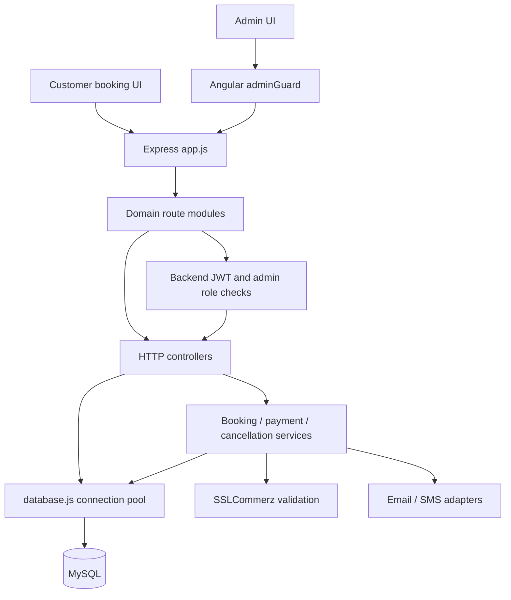

# KICKOFF ARENA architecture

The app uses Angular 18, Node.js/Express 4 and MySQL 8. Production serves the Angular build from `backend/public`; development can run Angular separately on port 4200. Existing API URLs are preserved by the refactor.

## Runtime structure

- `backend/server.js`: validates startup configuration, awaits migrations/readiness, starts HTTP and optionally the recurring scheduler, handles shutdown.
- `backend/app.js`: constructs Express without opening sockets or connecting to the database. Installs request logging, error handling, health checks, routers, static files and SPA fallback.
- `backend/routes/*.routes.js`: URL/method registration, authentication, policy acceptance and async rejection forwarding. Modules cover auth, bookings, admin bookings, calendar, slots, slot blocks, recurring, payments, settings and stats.
- `backend/controllers/*.controller.js`: request parsing, response/status mapping and notifications. Reporting/configuration queries remain close to their HTTP handlers; transactional booking/payment/cancellation rules are in services.
- `backend/services/bookings/booking.service.js`: hold ownership, conflict checks and confirmation in a transaction. Locks the slot to serialize concurrent hold/confirm requests. A valid owned hold is consumed in the same transaction that creates the booking.
- `backend/services/bookings/calendar.service.js`: reads an authenticated 1–7-day calendar snapshot in a consistent MySQL transaction and projects booking/block/season/hold availability without writes. The standalone Angular admin calendar is the default dashboard tab, with Week/Day views, read-only details and visibility-aware 30-second refresh. See [calendar behavior and API](docs/ADMIN_CALENDAR.md).
- `backend/services/bookings/cancellation.service.js`: cancellation preview/commit, refund records and validated payment crediting, sharing booking row locks. Refund settlement is manual; this service records completed transfers.
- `backend/services/payments/attempt.service.js`: reserves one unresolved attempt per booking under a booking row lock, maps idempotency keys to attempts, persists gateway session metadata, and reconciles server-verified terminal outcomes. Network calls run outside database transactions. Unknown timeouts/crashes remain blocked for reconciliation.
- `backend/services/payments/payment.service.js`: computes advance requirements, verifies gateway response amount/currency/status, then delegates transactional crediting. `sslcommerz.provider.js` owns gateway communication.
- `backend/services/bookings/cancellation-policy.js`: versioned bilingual refund policy (48+ hours 100%, 24–48 hours 50%, under 24 hours before kickoff 25%, at/after kickoff 0%). See its adjacent policy document for legacy behavior.
- `backend/database.js`: explicit pool lifecycle and callback compatibility for older reporting/services. Importing it has no database side effects.
- `backend/migrations/runner.js`: ordered, checksummed migrations with a database advisory lock and a `schema_migrations` ledger.

## Data and state

Core tables: `users`, `slots`, `slot_holds`, `slot_blocks`, `recurring_bookings`, `bookings`, `payment_transactions`, `payment_attempt_keys`, `app_settings`, `booking_cancellations`, `refund_settlements`, `schema_migrations`.

An individual booking moves from `pending` to `approved` or `cancelled`. Payment statuses are `unpaid`, `partially_paid`, `paid`; refund entitlement and returned money are recorded separately. Active slot/date uniqueness uses a generated column that becomes NULL for cancelled bookings, retaining their history while allowing rebooking. A late validated payment cannot reopen a cancelled booking and creates an additional refund entitlement.

Season templates move between `pending_approval`, `active`, `paused`, `cancelled`, `expired`. The scheduler generates individual occurrences for a rolling window. Run it in only one process (`SCHEDULER_ENABLED=true`); other HTTP workers must disable it. Pause/cancel an active season template before cancelling an individual occurrence. Cancelling a template does not automatically refund all generated bookings.

## Access and observability

`frontend/src/app/guards/admin.guard.ts` guards `/admin/dashboard`, sending missing/expired/non-admin browser sessions to `/admin/login`. Browser token checks are navigation UX only. Every admin API independently verifies the JWT signature, expiry and admin role. Production requires a configured JWT secret of at least 32 characters.

`/health/live` reports the HTTP process is alive. `/health/ready` verifies initialization and executes a database ping. Unknown `/api/*` paths return JSON 404 rather than Angular HTML. Requests have generated `X-Request-ID` values; structured logs record route templates, status and duration. Central error responses omit raw SQL/provider errors.

When `SENTRY_DSN` is configured, unexpected controller exceptions reach one centralized handler, retaining the original stack and request ID without duplicate capture. Expected validation/conflict errors preserve their status. `SENTRY_FRONTEND_DSN` is exposed only through the uncached `/runtime-config.js` endpoint and enables Angular exception reporting. DSNs are disabled when unset. Sentry events allowlist stack locations, release/environment and request correlation tags; arbitrary messages, request data, breadcrumbs and context are omitted; tracing and session replay are off. `release.json` in a release archive supplies the common release identifier for backend events, browser events and uploaded source maps.

## Testing and delivery

GitHub Actions runs backend syntax, policy/workflow/HTTP/gateway/observability tests, isolated MySQL concurrency/migration/backup-restore tests, Angular browser tests and the production build. `RUN_DB_TESTS=1` enables integration tests; they create and drop only uniquely named temporary databases. They never cancel a real customer's booking or call the payment gateway. Playwright tests exercise the real frontend/backend using isolated MySQL databases and a test-only gateway/notification adapter. A manually dispatched release workflow waits for these checks, requires Sentry settings, uploads private browser source maps, strips them from the deployable ZIP, verifies startup from the extracted production archive, and only then publishes it.

Production builds disable build-time remote font inlining; runtime font styling retains the existing browser fallback. Release packaging copies an allowlist of runtime files and the new Angular build into an archive, excluding private `.env`, dependencies and data. See [deployment and backup procedures](docs/DEPLOYMENT.md).

Customer OTP verification and automatic gateway refund transfers remain unimplemented. Existing public result/PDF/payment endpoints should receive a separate customer-authorization review before exposing additional personal data.

The booking result view derives payment messages from a server summary of verified transactions, not redirect query parameters. It distinguishes staff approval from online payment, polls boundedly for delayed callbacks, and restores the last booking ID on a same-tab refresh. Dialogs trap focus, restore it on close, and protect an in-progress submission/navigation from accidental dismissal. Migration 003 introduces attempt metadata; staff use `npm run payment:reconcile -- --transaction ID` for uncertain attempts. See the deployment guide for response states and recovery.
